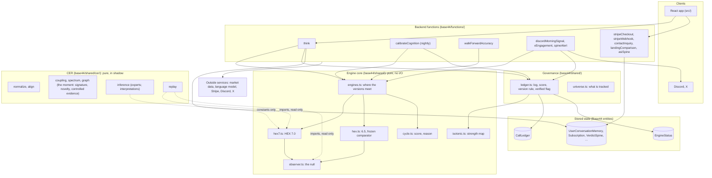

# HEX [PI]: architecture

Anna Maria Sarkisyan · Evrica Technologies Inc. · engine 7.0 on HEX6-BLE, with CER `cer-0.4` in shadow

One page for anyone who has to change, run, test or review this system: what
the parts are, what each may depend on, where state lives, and the practices
that keep it scalable, testable, private, recoverable and versioned. Each
statement points at the file that makes it true. Where something is not built
yet, it says so in section 12.

Related: the mathematics is in [`docs/MODEL.md`](docs/MODEL.md) and
[`docs/CER.md`](docs/CER.md); running the system is in
[`docs/OPERATIONS.md`](docs/OPERATIONS.md); the measurements are in
[`validation/README.md`](validation/README.md).

---

## 1. The system in one picture

Solid arrows are calls made in production. Dotted arrows are the only links
between CER and the engine: CER imports the engine's functions and changes
nothing in them. Nothing in production imports CER.

## 2. Layers and the dependency rule

Every file belongs to one layer. A layer may import from layers below it and
never from layers above.

| # | Layer | Where | Responsibility | May import |
|---|---|---|---|---|
| 5 | Clients | `src/` | Screens. Send messages, show answers. No mathematics, no secrets | the Base44 SDK |
| 4 | Functions | `base44/functions/*/entry.ts` | One entry point per job. All I/O happens here: database, market data, language model, payments, posts | 1, 2, 3 |
| 3 | Governance | `base44/shared/ledger.ts`, `universe.ts` | What is written down, how calls are scored through time, which version is shown, which reads are verified | 1, 2 |
| 2 | Presentation | `probabilityRead.ts`, `hex6Pipeline.ts`, `chartContext.ts`, `marketStory.ts`, `persona.ts`, `piusEngine.ts`, `piusResonance.ts`, `novelty.ts`, `triage.ts`, `stakes.ts`, `tickers.ts` | Turning a probability into a read and a prompt. Never changes a probability | 1 |
| 1 | Engine core | `observer.ts`, `hex7.ts`, `hex.ts`, `engines.ts`, `cycle.ts`, `isotonic.ts` | The mathematics. Pure functions of a series: no network, no database, no clock, no randomness | each other |
| 1s | CER (shadow) | `base44/shared/cer/` | Reading across channels. Pure, like the core | layer 1, read only |
| 0 | Single sources | `version.ts`, `modelRouter.ts`, `tickers.ts`, `universe.ts` | One place each for the version string, model IDs, symbols, the tracked list | nothing |

Why this matters for everything below:

- **Scalability.** The core is pure, so it can be run anywhere, in parallel,
  per series, with no coordination.
- **Unit testing.** Pure code is tested by feeding it numbers and comparing
  numbers. Only layer 4 needs stubs.
- **Recovery.** The core holds no state, so there is nothing of its own to
  restore.
- **Privacy.** Personal data exists only in layers 4 and 5 and in three
  entities. The mathematics never sees a person.

## 3. The engine core

| File | Role | Guarantee |
|---|---|---|
| `observer.ts` | The null `q0`: the series' usual odds | Never makes a call |
| `hex7.ts` | HEX 7.0: `logit p = logit q0 + beta . Z` | Starts at the null; learns online with no learning rate; order per step is predict, outcome, learn |
| `hex.ts` | 6.5, frozen | Runs beside 7.0 on every call as the comparator; not edited |
| `engines.ts` | The one place the versions meet | The only source of any probability shown |
| `cycle.ts` | Score and reason for every call | One measure: information gain over the null |
| `isotonic.ts` | Strength map | Restates strength; cannot change the side of a call |

The engine stores nothing between runs. Each time it is asked it walks the
series from its first bar. What it knows is a deterministic function of the
series alone (`docs/OPERATIONS.md`, section 2).

## 4. Governance: the loop around the engine

`calibrateCognition` runs nightly and is the only job that learns across
series (`ledger.ts`):

1. **Reveal and score** yesterday's open calls of both versions.
2. **Learn and predict**: each version walks each tracked series.
3. **Commit** tonight's calls to `CallLedger` before their outcomes exist.
4. **Decide**: refit the strength maps, apply the version rule, set the
   verified flag. One `EngineStatus` row per read.

Governance never writes into the engine. It changes what is shown (version,
strength, verified), not what the engine knows.

## 5. CER: the cross-environment module

**Status.** In `main`, in shadow. It makes its own calls on the same targets
and outcomes as HEX and is scored the same way. It is not wired to any
function, entity or screen.

| File | Role |
|---|---|
| `cer/types.ts` | `SignalObservation` (the input record: source, environment, channel, time, acquisition time, unit, quality, condition, intervention), `Channel`, `Edge`, `Graph`, `MomentSignature`, `EdgeWeight`, `Weighting`, and the version `cer-0.4` |
| `cer/normalize.ts` | Raw samples to a channel. Units kept; what is dropped is counted |
| `cer/align.ts` | Which value of a neighbour a call may see (`asof`); two channels on the ticks they share (`pair`); coordinates (HEX's own `ranks`) |
| `cer/coupling.ts` | Rank cross-correlation by lag, Bartlett standard error, time-shift surrogate threshold, shared-driver removal |
| `cer/spectrum.ts` | Welch coherence by band; phase only where coherent |
| `cer/graph.ts` | The moment `M_t = (X_t, G_t, Phi_t)`: the panel on the target's clock, its signature (harmony, leadership, counterpoint, rhythm, uncertainty), novelty at every call, and the controlled evidence for what may enter a forecast. Also the last-day descriptive graph and the frozen edge weight `w = A.L.C.Q` |
| `cer/inference.ts` | One expert per edge, learning from outcomes. The primary call: maximum entropy at T = 1 over the moment's controlled evidence. Three frozen comparators: by past success, by measured weight, by maximum entropy on edge evidence (with its temperature rule) |
| `cer/replay.ts` | `shadowReplay`: HEX's calls and CER's beside them, scored on the same outcome |
| `cer/index.ts` | The module's public surface. Import from here only |

**Isolation, as a rule that is checked.** CER imports `ranks`, `NZ`,
`PRIOR_SCALES`, `SHARE_RATES`, `walkHex7` and `observeBaseline`. It exports
nothing the engine imports. A change set that touches `observer.ts`,
`hex7.ts`, `cycle.ts`, `ledger.ts` or `isotonic.ts` is not a CER change.

**Two stages kept apart inside CER.** *Perception* builds the moment's
signature at every call: every relation, its timing, its uncertainty and its
novelty, with no outcome and no forecasting record in it. *Prediction* is a
separate calculation on the same panel: a neighbour may enter the forecast
only for what it adds given the target's own past, the calendar, the other
neighbours and timestamp availability. A relation that fails stays
perceived and is not asked.

| Mode (`Weighting`) | The call is formed from | Status |
|---|---|---|
| `'moment'` (default) | maximum entropy at T = 1 over the moment's controlled evidence for the pool and each edge | `cer-0.4`, primary |
| `'relaxation'`, `'relaxation-tempered'` | maximum entropy on per-edge evidence, at T = 1 or a validated temperature | `cer-0.3`, frozen comparator |
| `'measurement'` | `w = A.L.C.Q` | `cer-0.2`, frozen comparator |
| `'reliability'` | each expert's past predictive success | `cer-0.1`, frozen comparator |

The comparators are frozen in `validation/cer/frozen_manifest.json` and the
replay checks that they still reproduce their committed calls.

**What has been measured** (`validation/cer_results.md`): where one
environment physically leads another, CER adds to HEX (New York temperature
direction, +0.073 bits per call over 7.0); where there is no relationship it
reports none; on markets the relations are real, mostly simultaneous, and do
not forecast the next day. Perception is validated on its own: seven of
eight built configurations are resolved, and the eighth (phase near the
coherence threshold) is a stated limit.

**Gates before CER touches production**, in order. Each is a separate change
with its own pre-registration:

1. *Collect.* `collectSignals` and a `SignalObservation` entity, once there
   is a sensor feed. High-rate waveforms are reduced to per-tick features
   near the sensor; the application database holds features, not waveforms.
2. *Evaluate in shadow.* `evaluateResonance` writes `ResonanceSnapshot` and
   `ResonanceCall`. These are separate from `CallLedger` and `EngineStatus`
   and feed no decision.
3. *Candidate.* Only after shadow results are reproducible does a fusion
   candidate enter `engines.ts` as a new version, and it is then judged by
   the existing version rule like any other.

## 6. Stored state

| Entity | Holds | Written by | Personal data |
|---|---|---|---|
| `CallLedger` | Every call before its outcome, then its score | `ledger.ts` | none |
| `EngineStatus` | One row per read: version shown, verified flag, running tally, strength maps | `calibrateCognition` | none |
| `UserConversationMemory` | Rolling summary of a user's conversations, topics, style, boundary warnings | `think` | yes, keyed by email |
| `CognitiveState` | A read given in chat | `think` | user email |
| `VerdictSpine` | Hash chain of reads: content hash, prior hash, validators | `asiSpine.ts` | producer (email or engine); hashes, not content |
| `Subscription`, `User` | Stripe customer and subscription IDs, status, trial and period dates | `stripeWebhook` | yes |
| `Inquiry` | Contact form: name, email, message | `contactInquiry` | yes |
| `XEngagement` | X posts the system has handled | `xEngagement` | public posts only |

Every entity in `base44/entities/` is used. Fourteen that were not were
removed on 9 October 2026 (`CHANGELOG.md`).

Not stored: engine state, model coefficients, market data. All three are
recomputed.

## 7. Scalability

**What is measured** (`docs/OPERATIONS.md`, section 3): one engine run for
one series, both versions and both reads, 150 to 280 ms. A nightly update of
the 7 tracked series is about 1.5 s of engine time; at the cap of 27, about
6 s. Ledger growth is about 15 MB a year at 7 series and 60 MB at 27.

**How each part scales.**

| Part | Cost grows with | Limit set in | Next step when it binds |
|---|---|---|---|
| Engine | length of series × number of series, linearly | `universe.ts`: `HISTORY_DAYS` 5,475; `UNIVERSE` 7 + `MAX_EXTRA_SERIES` 20 | Persist each series' state after its last bar and resume; needs its own parity test against the full walk |
| Nightly job | number of series, one after another | one function invocation | Fan out one invocation per series; the core is pure, so this needs no locking |
| Ledger | 4 rows per series per night | 5,000 most recent scored rows read per night | `EngineStatus.tally` already keeps running sums, so the nightly decision does not reread history |
| CER inference | calls × (neighbours + 1) × 9 scales × 14² | neighbours passed by the caller | Hear edges by measured evidence: by past success, 26 neighbours cost about 0.0015 bits per call in accuracy; by measurement, 0.0000 to 0.0003 |
| CER moments | (calls / 25) × (neighbours² for counterpoint + one regression) on a 750-tick window; novelty per call is one small matrix solve | `graph.ts`: `RECOMPUTE`, `WINDOW` | About 25 minutes for the full replay. The frozen `A.L.C.Q` comparator is the expensive one (200 surrogates per edge) and is not on the primary path |
| CER graph | pairs² × 200 surrogates on a 750-tick window | `graph.ts`: `WINDOW`, `coupling.ts`: `NSUR` | Compute on a schedule, not per call; restrict to pairs within or adjacent to an environment |
| Sensor data | sample rate | not built | Feature extraction at the edge; a feature store and checkpoints separate from the application database |

**Practices.** No shared mutable state in the core. Idempotent nightly
writes (a rerun on the same day logs nothing twice). Every limit is a named
constant in one file. Timings are returned by the nightly job
(`elapsed_ms`, `per_series_ms`), so growth is visible before it hurts.

CER's TypeScript has not been timed yet. That measurement belongs to gate 2.

## 8. Testing

| Level | What | Command | Protects |
|---|---|---|---|
| Types | Every backend file | `npx tsc -p tests/tsconfig.check.json` | Interfaces between modules |
| Lint, build | Front end | `npm run lint`, `npx vite build` | The app builds |
| Unit, by parity | Null, 6.5, 7.0 against their Python references, step by step on real series | `node tests/parity.mjs` | The deployed mathematics is the tested mathematics (10⁻¹³) |
| Unit, by parity | CER against its Python reference on signals with built-in relationships, every mode; ingestion | `node tests/cer.mjs` | Same, for CER (4 × 10⁻¹³) |
| Perception, by construction | Eight built configurations, scored on perception only: timing with identical marginals, phase with equal correlation, shared driver against a real lead, a jointly informative pair, a novel combination, a relational transition, noise, a change of sampling | `python3 validation/cer_perception.py` | CER sees what is there before anything is forecast; false novelty stays at its nominal rate |
| Unit, by construction | Twelve CER tests: independence, locked oscillators, phase offset, known delay, shared driver, a relationship that stops, missing and asynchronous samples, spikes and a stuck sensor, no future data, exact repeatability, the measured edge weight, relaxation and its temperature | `python3 validation/cer_synthetic.py` | CER finds what was built in and nothing that was not |
| Integration | The loop, night by night, on real BTC bars with an in-memory database | `node tests/loop.mjs` | Scoring, logging, strength map, version rule |
| Smoke | Every backend function locally, with Base44, the language model and outside services stubbed | `node tests/backend-smoke/build.mjs && node tests/backend-smoke/run.mjs` | Every entry point runs; `docs/PROMPT.md` matches the code |
| Replay | One pass over every series; no call sees its own future | `python3 validation/replay.py`, `python3 validation/cer_replay.py` | The numbers in the documents |

**Rules.**

- Every piece of mathematics has a Python reference in `validation/` and a
  parity test in `tests/`. A change to one without the other fails.
- Every experiment has its predictions committed before it runs
  (`validation/prereg_*.md`) and its results written beside them, including
  the predictions that fail.
- A replay proves it used no future data by rerunning on truncated histories
  and comparing (7.0: 258 points, difference 0; CER: 144 points, difference 0).
- A relationship is reported only if it beats the same run on records
  displaced in time.

## 9. Privacy and security

**Where personal data is.** Only in the entities marked in section 6. The
engine core, CER, the ledger and all of `validation/` contain none: they hold
public series and probabilities.

**Access rules** (`base44/entities/*.jsonc`, `rls`). Create, update and
delete are admin-only on every entity that carries rules (`User` is Base44's
built-in). `UserConversationMemory` and
`Subscription` can be read by the user whose email is on the row, and by
admins. `CallLedger`, `EngineStatus`, `Inquiry`, `XEngagement` are
admin-read. `think` takes the user from the session; `walkForwardAccuracy`
requires a signed-in user; `asiSpine` requires the admin role.

**Secrets.** Stripe, Discord and X keys are Base44 secrets, read from the
environment at run time. None is in the repository; `.env*` is ignored.

**What leaves the system.**

| To | What | From |
|---|---|---|
| Language model (Base44 integration, with web context) | The user's message, the engine's read, the user's memory summary | `think` |
| Stripe | Email, checkout session | `stripeCheckout` |
| Discord, X | Posts written by the system; no user data | `discordMorningSignal`, `xEngagement`, `spineAlert` |
| Market data | A ticker symbol | `marketDataClient.ts` |

**Integrity.** `VerdictSpine` is a hash chain: each read given in chat is
committed as a content hash linked to the one before, so a later change to a
past read is detectable (`asiSpine.ts`). The ledger is written before
outcomes exist and is never back-filled.

**For CER, by design.** A `SignalObservation` describes a sensor, not a
person. If a deployment ever puts sensors in an occupied building, occupancy
can be inferred from heat and power, and those channels then need the same
per-owner read rule as `UserConversationMemory`. That rule is part of gate 1.

## 10. Recovery

| If this is lost or wrong | Recover from | How |
|---|---|---|
| Code, a bad change | Git history | Revert on `main`; Base44 picks it up; press Publish |
| A bad publish | The previous commit | Same |
| Engine state | Nothing to recover | It is recomputed from the series on the next run |
| `EngineStatus` | `CallLedger`, in part | The nightly job folds in scored days it has not counted, from the 5,000 most recent rows (`ledger.ts: foldDays`). Older days would need a rebuild script; see section 12 |
| A night the job did not run | The next run | Open calls are scored when their bars arrive; nothing is double counted |
| Market data for one ticker | The next run | It is listed in `failed` and skipped for that night |
| Replay results | Public data and the scripts | `validation/README.md`; the 7.0 ledger reproduces call for call |
| `CallLedger` itself | **Not recoverable from the repository** | See section 12 |

Every replay ledger row carries a hash of the engine state, the code and the
data seen so far, so two runs can be compared row by row.

## 11. Version control and release

- **One branch is live.** `main` is synced to Base44. A push to `main`
  appears in the Base44 Builder; the live app changes only when **Publish**
  is pressed there. Experiments are developed on a branch and merged when
  their results are written.
- **One version string**: `base44/shared/version.ts`. The ledger records
  which engine made each call (`state-6.5`, `hex-7.0`). CER records its own
  version (`cer-0.4`) on every edge and every ledger row. Superseded
  inference is not deleted: it is frozen with a manifest and kept selectable.
- **A frozen comparator.** A new engine version is added beside the previous
  one, which is frozen and kept running. Promotion is decided by the ledger,
  not by the commit.
- **Evidence is ordered in history.** The pre-registration is committed
  before the run, the results after. `git log` shows the order.
- **`CHANGELOG.md`** records every change in what the system does.
- **Checks before a merge to `main`**: every row of the table in section 8.
- **Generated files are not committed**: `node_modules`, build output,
  `tests/backend-smoke/out`, raw validation data.

## 12. Not built yet, or to be decided

Listed so nobody assumes otherwise.

1. **Automated checks.** The checks in section 8 are run by hand. There is no
   workflow that runs them on every push.
2. **Ledger backup.** `CallLedger` and `EngineStatus` live only in Base44. A
   scheduled export to storage outside it, and a script that rebuilds
   `EngineStatus.tally` from the whole ledger, are the missing recovery steps.
3. **Read rule left open.** `VerdictSpine`, which holds a producer email
   beside its hashes, has no read rule set. What Base44 does with an unset rule should be confirmed and the
   rule made explicit.
4. **Retention and deletion.** There is no stated period for keeping
   `UserConversationMemory` or `Inquiry`, and no function that deletes a
   user's rows on request.
5. **Release tags and licence.** No tags mark what was published, and the
   repository has no licence file.
6. **One market-data source.** A second source would turn an outage into a
   fallback.
7. **Mediation address.** `think` sends escalation mail to an address on the
   earlier domain (`MEDIATION_EMAIL`).
8. **CER in production.** Gates 1 to 3 of section 5.

## 13. Adding a module: the checklist

1. Decide its layer (section 2). If it needs I/O, the I/O goes in a function
   and the logic stays pure.
2. Give it one directory and one `index.ts`. Others import from the index.
3. Write the reference in `validation/` and the parity test in `tests/`.
4. Write the predictions (`validation/prereg_<name>.md`) and commit them
   before running anything on real data.
5. Run it in shadow, with controls. Write the results beside the predictions.
6. Put constants in one file, with names. Put its version in its outputs.
7. If it stores anything, add the entity with explicit rules for all four
   operations, and say in section 6 whether it holds personal data.
8. Add its row to sections 7 and 8 of this file, and an entry to
   `CHANGELOG.md`.
9. It reaches users only as a new version in `engines.ts`, judged by the
   existing rule.
